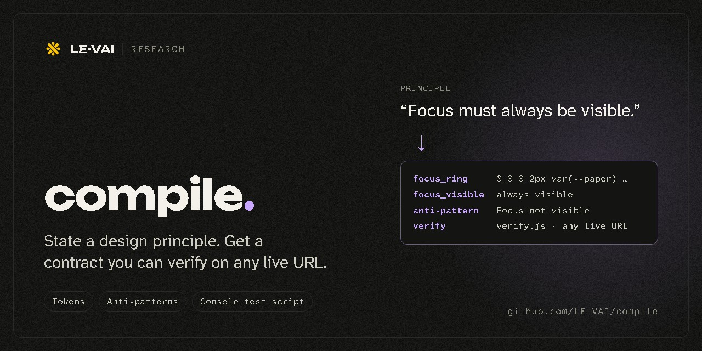
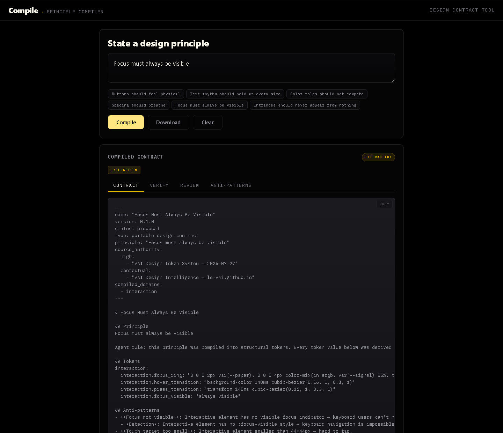

# Compile

<p align="center">
  <a href="https://le-vai.github.io/compile/"></a>
</p>

**A principle compiler.** Write a design principle in plain words, such as *Focus must always be visible*, and Compile turns it into a portable design contract: the tokens that carry it, the anti-patterns that break it, and a script that checks it on any live page.

**[Open Compile →](https://le-vai.github.io/compile/)**

## What you get

<p align="center">
  
</p>

One principle in, one contract out, in four views:

| View | What it holds |
|---|---|
| **Contract** | The portable contract: the principle, its tokens, anti-patterns with how to detect each one, a review checklist, provenance and open tensions |
| **Verify** | `verify.js`, a script you paste into the browser console on any live URL to check the page against the contract |
| **Review** | The checklist a person runs where automation cannot see |
| **Anti-patterns** | The failure modes the principle rules out |

Below the contract, a live preview applies the compiled tokens to a small surface so you can feel the principle before you ship it.

**Download** saves the set as four files:

| File | Use |
|---|---|
| `contract.md` | The portable contract block |
| `verify.js` | Paste into a browser console on any URL to verify |
| `tokens.css` | The compiled tokens as CSS custom properties |
| `README.txt` | What was compiled, and from which principle |

## Try a principle

Six examples are one click away on the page: *Buttons should feel physical*, *Text rhythm should hold at every size*, *Color roles should not compete*, *Spacing should breathe*, *Focus must always be visible*, and *Entrances should never appear from nothing*. Or type your own.

## Run it yourself

Compile is one static page. Clone the repo and open `index.html`, or serve the folder with any static server.

## Test

`test/run.mjs` checks the generated `verify.js`: every check must pass on `test/fixtures/pass.html`, fail on `test/fixtures/fail.html`, and give the right answer on Compile's own page. It drives Chrome through playwright-core, which the page itself does not need, so it is not a dependency:

```
npm i --no-save playwright-core
npm test
```

## License

MIT. See [LICENSE](LICENSE).
